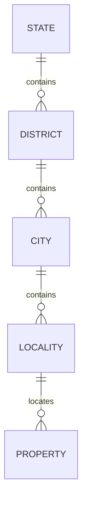

# Swastik Properties — Database Schema

## User

| Field | Purpose |
|---|---|
| id | Primary key inherited from Django |
| email | Required unique email and authentication identifier |
| username | Required unique account/display identifier |
| role | SUPER_ADMIN, ADMIN or AGENT |
| is_active | Account activation |
| is_staff | Django admin-site access |
| is_superuser | Django permission bypass |

Django's standard authentication fields and password hashing are retained through AbstractUser. Email is the login identifier; username remains required but is not used to authenticate.

## Normalized location hierarchy

State, District, City and Locality are maintained in the locations app. Property.locality is optional; a Google Maps URL and free-text location label/address can be stored even before a locality is configured.

## Property

| Field | Type | Purpose |
|---|---|---|
| id | BigAutoField | Primary key |
| property_reference | CharField(15), unique | Immutable SWP-prefixed identifier generated by the backend |
| name | CharField(200) | Public project/property name |
| slug | SlugField(220), unique | URL-safe name used by the detail endpoint |
| description | Text | Optional public description |
| developer_name | CharField(160) | Optional developer/promoter name |
| category | Choice | RESIDENTIAL, COMMERCIAL or LAND |
| subcategory | CharField(80) | Optional category-specific subtype |
| listing_type | Choice | SALE, RENT or LEASE |
| price | Decimal(14,2), nullable | Optional asking price in INR |
| currency | CharField(3) | INR by default |
| area_value | Decimal(12,2), nullable | Optional land/property area |
| area_unit | Choice | SQ_FT, SQ_M, ACRE or GUNTHA |
| location_name | CharField(200) | Human-readable locality/project location |
| full_address | Text | Optional full postal/site address |
| locality_id | FK to Locality, nullable | Optional normalized location reference; PROTECT on delete |
| location_url | URLField(1000) | HTTPS Google Maps URL |
| latitude / longitude | Decimal(10,7), nullable | Coordinates, extracted from supported Google Maps URLs where present |
| brochure | FileField | Uploaded PDF, maximum 25 MB |
| publication_status | Choice | DRAFT, PENDING_REVIEW, CHANGES_REQUESTED, APPROVED, PUBLISHED, REJECTED, ARCHIVED |
| availability_status | Choice | AVAILABLE, SOLD, RENTED, LEASED, UNAVAILABLE |
| created_by_id | FK to User, nullable | Admin who created the record; SET_NULL on user deletion |
| approved_by_id | FK to User, nullable | Admin who approved/published; SET_NULL on user deletion |
| approved_at / published_at | DateTime, nullable | Approval and publication timestamps |
| created_at / updated_at | DateTime | Audit timestamps |

### Property relationships and file lifecycle

- The brochure is stored under a property-specific media path.
- Replacing/deleting the property record removes its previously stored brochure after the database transaction commits.
- Property deletion is permanent.
- Customer submissions are a separate domain; when submission relations are implemented, they must use deletion behavior that preserves the submission record if a related property is deleted.
- Publication and availability are independent states.
- Anonymous users can read published properties only. Admin and Super Admin can manage all property records.

## Deferred domain models

- Property category-specific Residential, Commercial and Land detail tables.
- Property image gallery with one primary image.
- Property assignment and approval history.
- Customer submissions, attachments and export records.
- Property activity/audit log.
