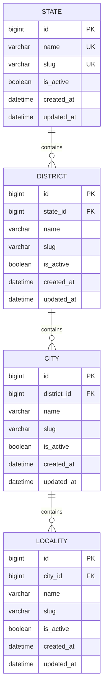

# Location Data Model and API

## Purpose

Provide normalized geographic reference data for Maharashtra first, while allowing further states and markets without changing the Property table structure.

## Hierarchy

## Data integrity

- State name and slug are unique.
- District name and slug are unique within a state.
- City name and slug are unique within a district.
- Locality name and slug are unique within a city.
- Parent foreign keys use `PROTECT` to prevent deleting a parent with dependent records.
- Deactivation is represented by `is_active=false`; inactive records and descendants are excluded from public lookup responses.
- Slugs are generated from names when not explicitly supplied.

## Initial Maharashtra seed

The command `python manage.py seed_maharashtra_locations` creates Maharashtra and its 36 districts. It is safe to run repeatedly and does not create duplicate records.

The district names use the current Government of Maharashtra/NIC district directory:
- https://maharashtra.s3waas.gov.in/
- https://igod.gov.in/index.php/sg/MH/E042/organizations

Cities and localities are not exhaustively preloaded. Super Admins add them through Django Admin as the business begins listing properties in those markets.

## Public API

All endpoints are anonymous GET-only lookups. POST, PUT, PATCH and DELETE are not exposed.

| Endpoint | Filters |
|---|---|
| `GET /api/v1/locations/states/` | search, ordering, page |
| `GET /api/v1/locations/districts/?state={id}` | state, search, ordering, page |
| `GET /api/v1/locations/cities/?district={id}` | district, state, search, ordering, page |
| `GET /api/v1/locations/localities/?city={id}` | city, district, state, search, ordering, page |

Responses expose parent IDs and names for frontend cascading selects. Pagination follows the global DRF configuration.

## Operational workflow

1. Run the seed command to create Maharashtra and its districts.
2. Super Admin adds the relevant cities.
3. Super Admin adds localities under each city.
4. Public website and dashboard load the hierarchy from APIs.
5. Property records reference normalized location rows, not hardcoded text lists.
6. The About page may show a curated service-area list editable through Site Content; it is separate from normalized geographic master data.
