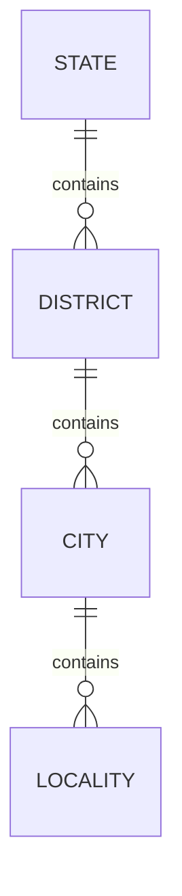

# Location Data Model and API

## Purpose

Provide normalized geographic reference data, seeded for Maharashtra first, while allowing additional states and markets without hardcoded frontend locality lists.

## Hierarchy



State contains districts, district contains cities, and city contains localities. Property records may reference the appropriate normalized location row.

## Integrity and lifecycle

- Names/slugs and parent-scoped uniqueness are enforced by the locations models/migrations.
- Parent relationships protect dependent records from accidental deletion where configured.
- Deactivation uses `is_active=false`; inactive records are excluded from public lookups according to queryset rules.
- Slugs are generated from names when not explicitly supplied.

## Maharashtra seed

Run from `backend`:

```powershell
python manage.py seed_maharashtra_locations
```

The command seeds Maharashtra and its district reference data and is designed to be safely rerunnable. Cities and localities are added as the business begins listing in those markets; they are not assumed to be exhaustive.

## Public API

All location lookup endpoints are anonymous GET lookups:

| Endpoint | Filter |
|---|---|
| `GET /api/v1/locations/states/` | Search/order/page |
| `GET /api/v1/locations/districts/?state={id}` | State, search/order/page |
| `GET /api/v1/locations/cities/?district={id}` | District and supported parent filters |
| `GET /api/v1/locations/localities/?city={id}` | City and supported parent filters |

Responses expose identifiers and parent context for cascading selectors. Exact pagination and optional query parameters are defined by the current DRF filters and OpenAPI schema.

## Frontend usage

- Marketplace destinations and property results must be derived from API-backed property records.
- Do not maintain a separate hardcoded city/locality catalogue in Angular.
- Curated marketing service areas, if introduced, are content data and must not be confused with the normalized location master.
